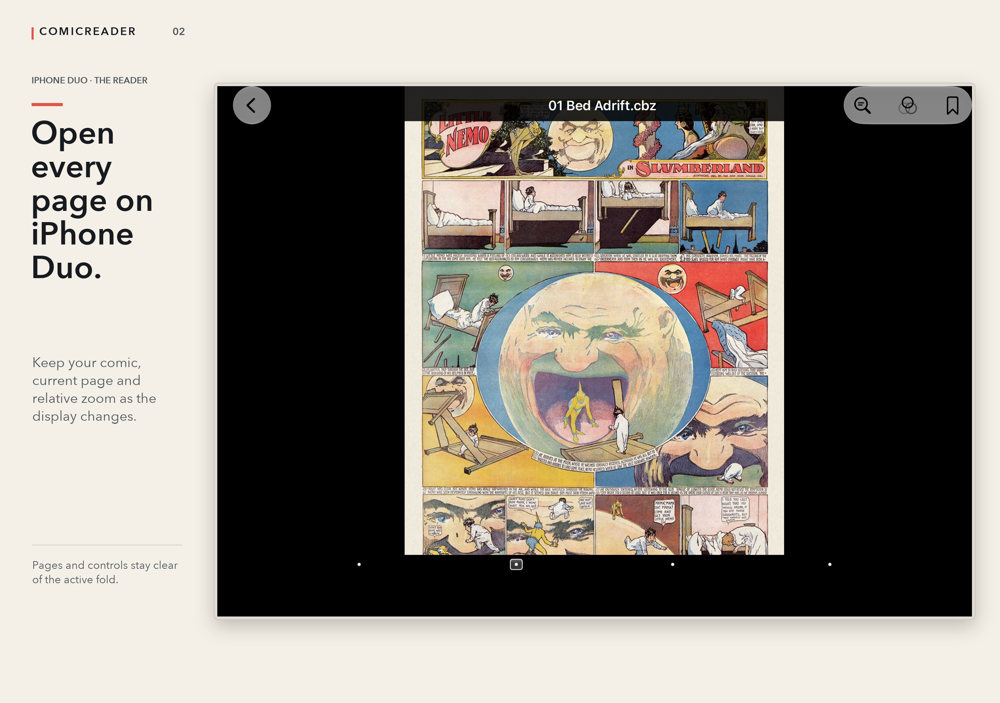

  

# ComicReader

**Your comics, across iPhone, iPad and Mac. Free reading and iCloud sync.**

Open up a page on iPhone Duo, pick up your library on iPad, or open a comic straight from Finder on Mac. ComicReader reads your own **PDF, CBZ/ZIP and classic CBR/RAR** files and continues the open-source [ComicFlow](https://github.com/swisspol/ComicFlow) project.

**[Download free on the App Store](https://apps.apple.com/app/apple-store/id1597314495?pt=10014801&ct=github_16&mt=8)** · **[Explore ComicReader and Plus](https://pclemente.github.io/ComicReader/)** · [Español](https://pclemente.github.io/ComicReader/es/)

## Start reading for free

- **iPhone Duo:** your page and relative zoom stay with you as the display changes. Artwork and controls adapt around the active fold.
- **iPhone, iPad and Mac:** optionally sync library comics, read status and your current page using your own iCloud storage.
- **Open directly on Mac:** use Finder → Open With → ComicReader, or Command-O. Choose **Add to Library** when you want a library copy with saved progress and optional sync.
- **Bring your collection:** import files, organise collections, read imported comics offline, and transfer with the local-network uploader or WebDAV.
- **Read the words, too:** recognise text on the current page, then copy or share a phrase. Browse websites inside the app, save shortcuts, and manage normal or private sessions.

No comics are bundled. Direct Mac reading does not save progress after closing; adding the comic to your library does. iCloud sync is optional and requires sufficient personal storage and an internet connection.

## Make more of your library with Plus

**One optional purchase. No subscription.** The base price in Spain is **€9.99**; the App Store shows your local price before purchase. Restore the same purchase on iPhone, iPad and Mac using the same Apple Account. Existing Plus owners receive the new tools.

| Plus tool | What it helps you do |
| --- | --- |
| Website Imports | Download supported comic files into a chosen collection, with validation, duplicate detection and a download queue. |
| Comic Search & Quotes | Index the comic you are reading, search its pages and keep editable quotes linked to their source page. |
| Reading Lists & Smart Queues | Plan your reading order and gather Continue Reading, Unread and Read Again across folders. |
| Named Page Bookmarks | Return to a favourite page with a name you remember. |
| Image Filters | Try Clear Ink, Grayscale or Warm Paper without changing the original file. A free preview is included. |

Open **Get Plus** in the library to see the tools, local price and **Restore Purchases**. Reading, ordinary imports, browsing, current-page text recognition and iCloud remain free.

Search covers the current library comic, not the whole library; recognition quality varies. Search indexes, quotes, lists and bookmarks stay on each device. Websites must offer supported downloadable files; no catalogue or DRM removal is included. Keep the app open until website imports finish.

## Help and development

ComicReader 1.6 is available on the App Store. The app interface is in English. It supports iOS/iPadOS 15 or later and macOS 12 or later; Duo adaptation uses the iOS 27.1 APIs.

- [Opening comics on Mac and choosing a default reader](docs/MacDocuments.md)
- [Website imports, sessions and privacy](docs/WebBrowser.md)
- [Plus setup and purchase validation](docs/PlusUpgrade.md)
- [Adaptive reading and Duo validation](docs/AdaptiveReader.md)
- [Regression tests and build commands](docs/RegressionReview.md)
- [1.6 release and validation records](release/app-store/1.6/README.md)
- [Report a bug or request a feature](https://github.com/pclemente/ComicReader/issues)

To build, open `ComicFlow.xcodeproj` in Xcode 27.1 and select the shared `ComicFlow` scheme. Run Product → Test on an iPad simulator for the regression suite. Contributions are welcome.

Third-party analytics are not integrated. Apple's App Store Connect provides aggregate store metrics and usage/crash data for users who opt in to Apple's sharing setting. See the [production crash review](docs/CrashReview2026-10-23.md).

## License and credits

ComicFlow is copyright 2010–2014 Pierre-Olivier Latour. ComicReader is maintained by [Pablo Clemente Pérez](https://pabloclementeperez.com/) and released under the same [GNU GPL v3 license](LICENSE). Included third-party projects retain their own licenses.

Screenshots use public-domain *Little Nemo* artwork by Winsor McCay; [image sources](release/app-store/sample-comics/sources.json). Sample comics are not included in the app.
