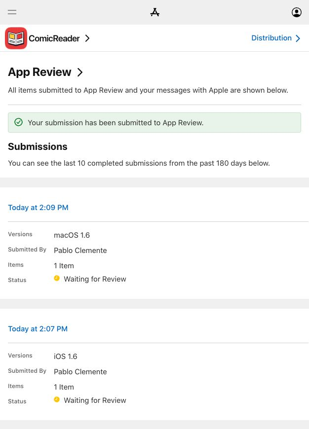

# ComicReader 1.6 (14) submission

This release adds direct Mac document opening, the web-to-library Plus
workflow and native StoreKit review requests after meaningful reading.
Third-party analytics are deliberately absent. The existing €9.99 Spain-base
non-consumable is retained; iCloud, Duo support, direct Mac reading and browsing
remain free. Both platforms were submitted on 23 October 2026 and verified as **Waiting for Review**. Release is automatic after approval. See `submission.json` for build and submission identifiers.

The submitted 1.6 versions on both platforms include the new description, promotional text,
keywords and review notes. Both retain five screenshots per supported gallery;
the iOS galleries include iPhone, Duo and iPad. Both have the public-domain review
sample attached. Unrestricted Web Access is declared for the browser. The Books
category and Duo subtitle replace the previous Utilities category and generic
subtitle. Free and Paid Apps agreements were active when checked on 23 October.

The product positioning leads with opening the Duo screen and keeping your
place, then direct Mac reading and free iCloud continuity. Plus is presented at
the point of use and in the news banner as one optional purchase for website
imports, comic search, quotes and reading tools. Existing owners receive the
new tools. No subscription, exclusivity or "first reader" claim is made.

See `docs/MacDocuments.md`, `docs/WebBrowser.md`,
`docs/CrashReview2026-10-23.md` and the validation record for implementation,
privacy and test details. Historical 1.5 submission evidence is unchanged.

Both archives were built from `05f756c661d5d2b63109ca3f8ece61b1bc0fda3a`.
Production signatures, iCloud permissions, matching symbols and absence of test
artifacts were verified in both exported packages. The Mac package includes
Apple silicon and Intel architectures with read-only selected-file access.

